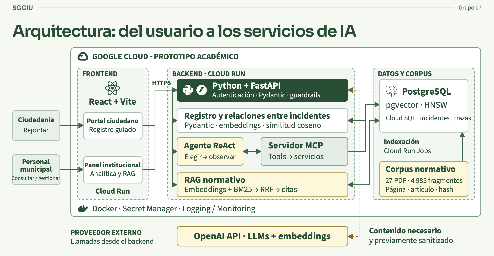

<div align="center">

# SGCIU

### Sistema de Gestión y Clasificación de Incidentes Urbanos

**IA aplicada a la gestión municipal · Costa Rica**<br>
Trabajo Final de Máster · Grupo 7 · Versión 1.0.0

[](https://github.com/andazo/SGCIU/actions/workflows/backend-ci.yml)
[](https://github.com/andazo/SGCIU/actions/workflows/codeql.yml)
[](https://www.linkedin.com/in/andazo)
[](presentation/SGCIU-defensa-respaldo.pdf)

[Explorar el proyecto](#explora-el-proyecto) · [Arquitectura](#arquitectura) · [Instalación](#inicio-rápido-con-docker) · [Resultados](#resultados-de-evaluación) · [Documentación](#documentación-técnica)

</div>

SGCIU es un MVP para apoyar el registro, la clasificación, el análisis y la consulta de
incidentes urbanos de la Municipalidad de Flores, Costa Rica. Automatiza tareas repetitivas
de recepción y análisis para que el personal pueda dedicar más tiempo a vigilancia y
seguridad ciudadana. La información estructurada también sirve para identificar los
incidentes más frecuentes, patrones recurrentes y zonas que requieren atención prioritaria.

## Explora el proyecto

| Quiero… | Ir a… |
| --- | --- |
| Probar el registro ciudadano | [Abrir portal ciudadano](https://sgciu-frontend-edoinmx35a-uc.a.run.app/) |
| Acceder como personal municipal | [Abrir panel institucional](https://sgciu-frontend-edoinmx35a-uc.a.run.app/admin) · requiere cuenta autorizada |
| Entender la solución | [Arquitectura](#arquitectura) · [Funcionalidades](#funcionalidades-de-la-versión-100) |
| Revisar la defensa del máster | [Presentación final en PDF](presentation/SGCIU-defensa-respaldo.pdf) |
| Ejecutar o contribuir al código | [Inicio con Docker](#inicio-rápido-con-docker) · [Calidad y evaluación](#calidad-y-evaluación) · [Flujo de ramas](docs/development-workflow.md) |
| Revisar los controles de seguridad | [Política de seguridad](SECURITY.md) · [Auditoría de publicación](docs/security-audit.md) |

> **Prototipo académico.** La IA apoya el análisis y la priorización; la decisión institucional permanece bajo supervisión humana. SGCIU no sustituye al 9-1-1 ni a los protocolos de emergencia.

## Funcionalidades de la versión 1.0.0

| Módulo | Qué permite hacer | Conocer más |
| --- | --- | --- |
| 📝 Registro ciudadano | Reportar de forma guiada, identificada o anónima, y corregir información durante la conversación | [Flujo de denuncia](docs/architecture.md#flujo-de-denuncia) |
| 🏛️ Panel institucional | Registrar, consultar y revisar incidentes mediante cuentas con roles | [Uso del panel](#uso-del-panel-institucional) |
| 🔎 Inteligencia de incidentes | Buscar por significado y detectar relaciones y patrones recurrentes | [Arquitectura](docs/architecture.md) |
| 🧰 Agente operativo | Consultar herramientas tipadas mediante ReAct y MCP | [Flujo del agente](docs/architecture.md#flujo-del-agente-operativo) |
| 📚 Asistente normativo | Recuperar normativa con citas verificables y abstenerse cuando falta evidencia | [Guía del RAG](docs/legal-rag.md) |
| 📊 Evaluación y trazabilidad | Medir calidad, latencia, uso y costes con escenarios sintéticos | [Pruebas](docs/testing.md) · [Monitorización](docs/monitoring.md) |

<details>
<summary><strong>Ver todas las capacidades técnicas</strong></summary>

- Intake conversacional ciudadano, identificado o anónimo, con correcciones acumulativas.
- Registro interno de incidentes por personal policial o administrativo.
- Clasificación, resumen, entidades, urgencia, evidencia y confianza por campo.
- Revisiones de calidad ante datos incompletos, contradictorios o ambiguos.
- Embeddings con PostgreSQL y `pgvector` para búsqueda y similitud semántica.
- Agrupación proactiva de incidentes similares en ventanas móviles de 30 días.
- Agente operativo ReAct con herramientas tipadas, límite de pasos y trazas sanitizadas.
- Servidor MCP sin acceso a SQL arbitrario.
- RAG normativo con recuperación híbrida, abstención y citas por documento, página y artículo.
- Panel institucional con autenticación por roles y sesiones revocables.
- Logs estructurados, métricas Prometheus y estimación de costes por modelo.
- Evaluaciones reproducibles mediante datos completamente sintéticos.

</details>

## Arquitectura

[](docs/assets/arquitectura-usuario-servicios-ia.png)

*Selecciona el diagrama para verlo a tamaño completo.*

React sirve la interfaz ciudadana y el panel institucional. FastAPI concentra la API, la
autenticación, los servicios de dominio y las capacidades de IA. PostgreSQL conserva los
datos transaccionales, vectores y trazas en estructuras separadas. El backend solo envía a
OpenAI el texto necesario para cada operación; los campos estructurados de contacto quedan
fuera de embeddings, herramientas y trazas.

[Explorar la arquitectura completa y sus flujos →](docs/architecture.md)

<details>
<summary><strong>Ver diagramas técnicos complementarios</strong></summary>

El [diagrama de datos y pipelines](docs/assets/diseno-datos-pipelines-sgciu.png) detalla la
separación entre las denuncias ciudadanas y el corpus jurídico del RAG. Las versiones SVG de
este diagrama y del [diagrama técnico de arquitectura](docs/assets/arquitectura-sgciu-profesional.png) se conservan en `docs/assets/` como fuentes editables.

</details>

## Inicio rápido con Docker

Esta es la ruta recomendada para ejecutar el sistema completo. Docker Compose levanta
PostgreSQL con `pgvector`, aplica las migraciones y construye el backend y el frontend; no
es necesario instalar Python ni Node.js en el equipo anfitrión.

### Requisitos

- Git.
- Docker Desktop, o Docker Engine con Compose v2.
- `make`.
- Una clave de la API de OpenAI.

### 1. Descargar y configurar

```bash
git clone https://github.com/andazo/SGCIU.git
cd SGCIU
make bootstrap
```

Abra el archivo `.env` creado por el último comando y complete esta línea:

```dotenv
OPENAI_API_KEY=su_clave_de_openai
```

Los demás valores ya tienen opciones adecuadas para el entorno local.

### 2. Iniciar y comprobar

```bash
make up
make smoke
```

La primera construcción puede tardar varios minutos. Cuando `make smoke` termine sin
errores, estarán disponibles:

| Servicio | Dirección |
| --- | --- |
| Registro ciudadano | <http://localhost:5173> |
| Panel institucional | <http://localhost:5173/admin> |
| API | <http://localhost:8000> |
| Documentación OpenAPI | <http://localhost:8000/docs> |

<details>
<summary><strong>Administrar el entorno local y crear usuarios institucionales</strong></summary>

### 3. Operar el entorno

```bash
make status   # estado de los servicios
make logs     # logs en tiempo real
make down     # detener sin borrar los datos
```

El volumen `sgciu_postgres_data` conserva la base de datos entre reinicios. Para reiniciar
todo desde cero, incluida la base de datos local, ejecute `docker compose down -v`.

### Usuarios institucionales

La autenticación puede permanecer desactivada durante el desarrollo local. Para probarla o
preparar usuarios institucionales, cree las cuentas desde el contenedor del backend:

```bash
docker compose exec backend python -m app.cli --create-user policia.flores --user-role police
docker compose exec backend python -m app.cli --create-user administrativo.flores --user-role administrative
```

El comando solicita la contraseña de forma interactiva. SGCIU almacena un hash
PBKDF2-SHA256 con salt único y nunca guarda la contraseña en texto claro.

</details>

## Uso del panel institucional

En <http://localhost:5173/admin> se encuentran los flujos de registro interno, consulta de
incidentes, revisiones de calidad, patrones recurrentes, agente operativo y asistente de
políticas. El badge identifica la procedencia del registro interno; la autenticación real se
realiza mediante las sesiones institucionales.

El flujo ciudadano admite reportes con datos de contacto o anónimos. En modo anónimo, el
backend descarta cualquier dato de contacto enviado por el cliente. La orientación al 9-1-1
se muestra una sola vez por sesión cuando se detecta peligro inmediato, sin interrumpir la
extracción de la información disponible.

<details>
<summary><strong>Cargar incidentes sintéticos para una demostración</strong></summary>

### Cargar datos sintéticos

El repositorio incluye 50 incidentes ficticios para probar búsquedas, embeddings, patrones,
revisiones y el agente operativo. Con los servicios activos y la clave de OpenAI configurada:

```bash
docker compose exec backend python -m app.evaluation.seed_incidents
```

La carga es idempotente: las ejecuciones posteriores omiten los casos existentes. Ningún
relato del dataset corresponde a una denuncia real.

</details>

### Consultar el RAG normativo

Abra **Asistente de Políticas** en el panel institucional. Antes de la primera consulta,
seleccione **Indexar o actualizar documentos**. El proceso valida checksums, extrae el texto
sin cruzar páginas y genera los embeddings de 4.985 fragmentos procedentes de 27 documentos.
Las ejecuciones posteriores omiten los archivos cuyo contenido, modelo e indexador no hayan
cambiado.

Cada respuesta incluye el documento, la página física del PDF, el artículo detectado, las
señales de recuperación y un identificador de traza. El módulo se abstiene cuando la evidencia
recuperada no basta para fundamentar una respuesta. La [guía del RAG](docs/legal-rag.md)
describe el corpus, sus vacíos conocidos y la operación completa.

<details>
<summary><strong>Utilizar la interfaz de terminal opcional</strong></summary>

### Interfaz terminal opcional

Con los contenedores activos también puede utilizarse la CLI:

```bash
docker compose exec backend python -m app.cli --role citizen
docker compose exec backend python -m app.cli --role admin --transport local
docker compose exec backend python -m app.cli --role admin --transport mcp
```

</details>

## Resultados de evaluación

La versión 1.0.0 se evaluó mediante 90 escenarios sintéticos y 100 pruebas automatizadas, con 78,76 % de cobertura del backend en aquella entrega.

| Indicador de la evaluación académica | Resultado |
| --- | ---: |
| Escenarios sintéticos | 90 |
| Acierto de categoría | 90 % |
| Acierto de distrito / fecha | 100 % / 100 % |
| Relaciones entre incidentes | 84,4 % |
| Acierto de tipo de lugar | 10 % |
| Recall / precisión de agrupación | 97,2 % / 39,8 % |
| F1 de agrupación | 56,5 % |
| Coste medio observado por escenario | USD 0,0533 |

La [auditoría posterior de seguridad](docs/security-audit.md) registró **114 pruebas aprobadas y 79,31 % de cobertura**; estas cifras corresponden a una ejecución distinta de la evaluación académica.

La precisión baja de la agrupación y el desempeño del tipo de lugar justifican mantener la
revisión humana y tratarlos como líneas de mejora. El coste observado para los 90 escenarios
fue de USD 4,7955, equivalente a USD 0,0533 por caso.

## Calidad y evaluación

La validación ordinaria se ejecuta desde la raíz:

```bash
make verify
```

Este comando revisa el estilo del backend, ejecuta las pruebas con cobertura, construye el
frontend y valida Docker Compose. Las pruebas sustituyen las conexiones externas por dobles
deterministas ubicados en `backend/tests/`; no consumen la API de OpenAI.

La suite E2E recorre por HTTP los módulos ciudadano y administrativo:

```bash
make e2e
```

Las evaluaciones de modelos sí realizan llamadas a OpenAI y pueden generar costes:

```bash
cd backend
PYTHONPATH=. .venv/bin/python -m app.evaluation.runner
PYTHONPATH=. .venv/bin/python -m app.evaluation.legal_rag_runner
PYTHONPATH=. .venv/bin/python -m app.evaluation.module_runner --modules all --seed-incidents
```

El conjunto legal contiene 21 consultas sintéticas. El runner unificado guarda resultados,
hash del dataset, modelos y revisión desplegada en `evaluation_runs`. La línea base del RAG
permanece versionada en `backend/evaluation/legal_rag_baseline.json` para conservar la
trazabilidad de las comparaciones.

La estimación mensual se recalcula con `make cost-report`. Los supuestos y la diferencia entre
estimación e importe facturado se explican en la [guía de costes](docs/costs.md).

<details>
<summary><strong>Consultar la configuración de IA y la estructura del código</strong></summary>

## Configuración de IA

El runtime usa servicios de OpenAI. `OPENAI_MODEL` selecciona el modelo general y
`OPENAI_INTAKE_MODEL` controla por separado la recepción ciudadana.
`INTAKE_REASONING_EFFORT` y `INTAKE_MAX_FOLLOW_UPS` ajustan la profundidad y extensión del
intake. El RAG utiliza `LEGAL_RAG_MODEL` y `LEGAL_RAG_EMBEDDING_MODEL`; el corpus en español
usa por defecto `text-embedding-3-large` con 1.536 dimensiones. Los embeddings jurídicos no
se mezclan con los de incidentes. Todas las variables disponibles están documentadas en
[`.env.example`](.env.example).

## Componentes principales

```text
backend/app/
├── agents/       # ciclo ReAct y gateways local/MCP
├── ai/           # intake, embeddings y guardrails
├── api/          # endpoints versionados y control de acceso
├── evaluation/   # métricas y runners de regresión
├── services/     # casos de uso y reglas de dominio
└── tools/        # herramientas tipadas compartidas por el agente y MCP

frontend/src/
├── App.jsx       # flujos, formularios y paneles de la versión 1.0.0
├── main.jsx      # punto de entrada de React
└── styles.css    # estilos de la interfaz
```

Los formularios actuales se consolidaron en `App.jsx`; la antigua configuración estática
de `formQuestions.js` ya no formaba parte de la aplicación y se retiró en la versión 1.0.0.

</details>

## Presentación final

[Ver la presentación en PDF](presentation/SGCIU-defensa-respaldo.pdf)

## Documentación técnica

| Tema | Guías |
| --- | --- |
| Diseño y aplicación | [Arquitectura](docs/architecture.md) · [Frontend](frontend/README.md) · [RAG normativo](docs/legal-rag.md) |
| Ejecutar y desplegar | [Google Cloud](docs/gcp-deployment.md) · [Flujo de ramas](docs/development-workflow.md) |
| Evaluar y observar | [Pruebas automatizadas](docs/testing.md) · [Evaluación manual de IA](docs/manual-evaluation.md) · [Monitorización](docs/monitoring.md) |
| Costes y seguridad | [Estimación de costes](docs/costs.md) · [Auditoría](docs/security-audit.md) · [Política de seguridad](SECURITY.md) |

## Autor

**Andrés Azofeifa García** · Único integrante del Grupo 7.

[LinkedIn](https://www.linkedin.com/in/andazo) · [GitHub](https://github.com/andazo)

[↑ Volver al inicio](#sgciu)
