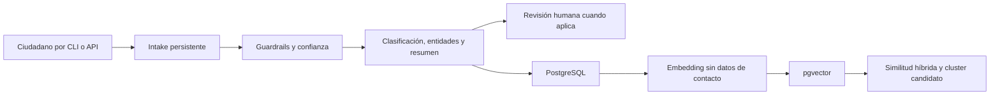
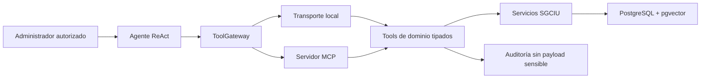

# Arquitectura del backend SGCIU

## Principios

- La IA propone clasificaciones y relaciones; una persona mantiene la decisión final.
- El agente no accede a SQL ni a credenciales de base de datos.
- Los tools devuelven únicamente información operativa sanitizada.
- La indexación semántica no incluye nombre, correo ni teléfono del denunciante.
- Cada llamada HTTP, tool y ejecución del agente puede relacionarse mediante un trace ID.
- Los proveedores de LLM y embeddings se sustituyen mediante interfaces explícitas.

## Flujo de denuncia

## Flujo del agente operativo

El loop ReAct tiene un máximo configurable de pasos. La traza pública contiene nombre de
tool, claves de argumentos, latencia, éxito y cantidad de resultados; no contiene el
razonamiento interno del modelo.

## Tools MCP

| Tool | Lectura/escritura | Propósito |
|---|---|---|
| `get_incident` | Lectura | Recuperar un incidente sanitizado |
| `search_incidents` | Lectura | Filtrar por distrito y categoría |
| `aggregate_incidents` | Lectura | Obtener conteos deterministas mediante SQL |
| `find_related_incidents` | Lectura | Aplicar recuperación semántica híbrida |
| `get_incident_cluster` | Lectura | Inspeccionar un cluster candidato |
| `request_human_review` | Escritura acotada | Crear una revisión humana |

No existe un tool para ejecutar SQL libre, modificar clasificaciones o eliminar datos.

## RAG normativo pendiente

El asistente de políticas municipales se incorporará cuando exista un corpus autorizado y
versionado. Tendrá un índice separado, citas obligatorias y abstención cuando no exista
evidencia. No debe mezclarse con los embeddings de denuncias.
