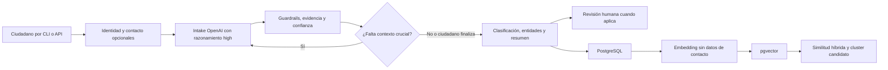
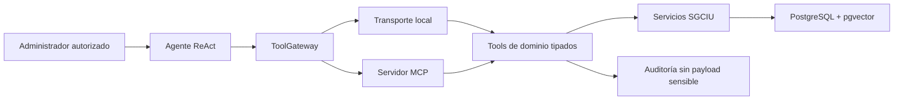

# Arquitectura del backend SGCIU

## Principios

- La IA propone clasificaciones y relaciones; una persona mantiene la decisión final.
- El agente no accede a SQL ni a credenciales de base de datos.
- Los tools devuelven únicamente información operativa sanitizada.
- La indexación semántica no incluye nombre, identificación, correo ni teléfono del denunciante.
- Cada llamada HTTP, tool y ejecución del agente puede relacionarse mediante un trace ID.
- El runtime utiliza OpenAI para LLM y embeddings; las interfaces permiten inyectar dobles
  exclusivamente durante pruebas automatizadas.

## Flujo de denuncia

Los datos personales viajan por una ruta determinista hasta PostgreSQL. El relato estructurado
se procesa por separado y únicamente su versión sanitizada alimenta embeddings y tools. El
administrador humano puede consultar los datos de contacto directamente, pero el agente no los
recibe en su contexto.

El intake conserva por campo un valor, un estado (`known`, `missing`, `ambiguous`, `unknown` o
`declined`), confianza y evidencia textual. Solo los estados `missing` y `ambiguous` generan
follow-ups. El ciudadano puede finalizar explícitamente y el sistema persiste la denuncia
parcial con su razón de cierre y campos no resueltos. Las respuestas estructuradas se solicitan
con esquema Pydantic, razonamiento aislado al intake y almacenamiento de respuesta desactivado.

## Flujo del agente operativo

El loop ReAct tiene un máximo configurable de pasos. La traza pública contiene nombre de
tool, claves de argumentos, latencia, éxito y cantidad de resultados; no contiene el
razonamiento interno del modelo.

## Tools MCP

| Tool | Lectura/escritura | Propósito |
|---|---|---|
| `get_incident` | Lectura | Recuperar un incidente sanitizado |
| `search_incidents` | Lectura | Filtrar por distrito y categoría |
| `aggregate_incidents` | Lectura | Obtener conteos deterministas mediante SQL |
| `find_related_incidents` | Lectura | Aplicar recuperación semántica híbrida |
| `get_incident_cluster` | Lectura | Inspeccionar un cluster candidato |
| `request_human_review` | Escritura acotada | Crear una revisión humana |
| `search_legal_sources` | Lectura | Recuperar normativa con página y artículo |
| `get_legal_corpus_status` | Lectura | Inspeccionar versión, cobertura y embeddings |

No existe un tool para ejecutar SQL libre, modificar clasificaciones o eliminar datos.

## RAG normativo

```mermaid
flowchart LR
    PDF["PDF oficial versionado"] --> Verify["Checksum SHA-256"]
    Verify --> Pages["Extracción por página"]
    Pages --> Chunks["Chunks de ~512 tokens y 15% overlap"]
    Chunks --> LegalEmb["text-embedding-3-large, 1536 dimensiones"]
    LegalEmb --> LegalVector["Índice HNSW legal en pgvector"]
    Question["Consulta autorizada"] --> Hybrid["Recuperación híbrida"]
    LegalVector --> Hybrid
    Hybrid --> Context["Top-k con documento, página y artículo"]
    Context --> LLM["Generación grounded con salida estructurada"]
    LLM --> Validate{"¿Citas válidas?"}
    Validate -->|Sí| Answer["Respuesta + fuentes + trace ID"]
    Validate -->|No| Abstain["Abstención segura"]
```

El índice legal se mantiene separado del índice de incidentes. Los chunks nunca cruzan una
página física de PDF, por lo que `pdf_page` es reproducible contra el archivo cuyo SHA-256
está en el manifiesto. El texto para embedding incorpora título, sección y artículo; el texto
mostrado como evidencia conserva el contenido extraído.

La recuperación combina similitud coseno y BM25 mediante reciprocal-rank fusion. HNSW reduce
los candidatos densos en PostgreSQL, mientras que el componente léxico protege términos
exactos como números de ley, artículos y nombres de protocolos. Los scores son señales de
ordenamiento, no probabilidades ni confianza jurídica.

La generación solo recibe los fragmentos recuperados, usa identificadores `[F#]` y devuelve
una estructura Pydantic. Una validación posterior descarta identificadores inexistentes y
falla de forma cerrada si una respuesta afirmativa no tiene atribución verificable. Las
consultas se auditan mediante hash, IDs de chunk, versión de prompt/modelo, latencia y uso,
sin persistir el texto original de la pregunta.
